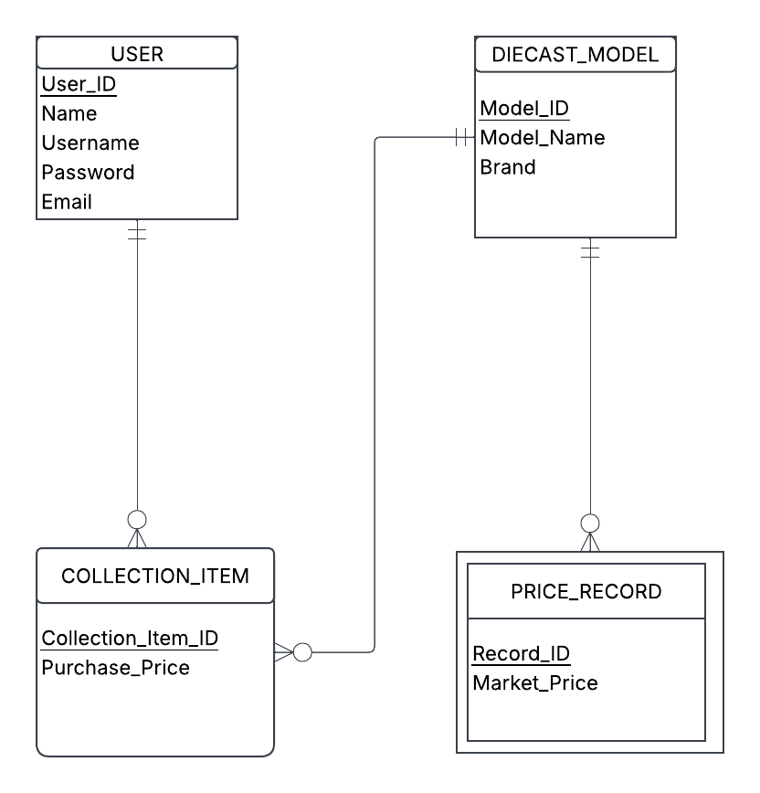
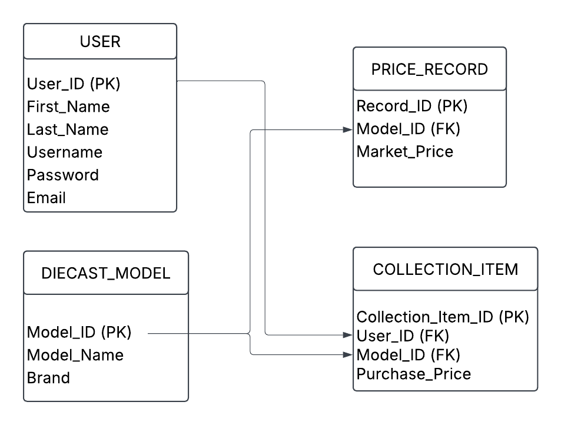

# Quantum Drift

## About the Project

Quantum Drift is a website created for 1/64 scale diecast collectors. I created this project because I am a collector myself and have always enjoyed collecting Hot Wheels and other small-scale model cars.

There is something special about having a highly detailed car in a small 1/64 scale. Whether it is a regular Hot Wheels mainline, a chase model, or a premium diecast, collecting is about finding cars that you enjoy and building a collection over time.

However, some diecast cars can become very expensive because of hype, limited availability, and aftermarket markups. Quantum Drift was created to help collectors find useful information about diecast cars and make smarter decisions before buying.

## Our Mission

Quantum Drift is built by a collector, for collectors. The goal is to help people find good-quality 1/64 diecast cars at reasonable prices while learning more about the models they collect.

The website focuses on:

* **Price Checking** – Helping collectors understand whether a diecast car is worth its current price.
* **Price Tracking** – Looking at market prices to help collectors decide when to buy or wait.
* **Quality Inspections** – Looking at details such as paint, wheels, tampos, and casting accuracy.
* **Smart Collecting** – Providing tips to help collectors build their collections without spending more than necessary.

## Why I Created Quantum Drift

I created Quantum Drift because I enjoy collecting Hot Wheels and 1/64 scale diecast cars. One of my favorite parts of collecting is finding a car that I have been looking for, whether it is a mainline, special release, chase piece, or premium model.

At the same time, collecting can become expensive. Popular models can sometimes be difficult to find in stores and can be sold for much higher prices online. I wanted to create a website that focuses on the hobby from a collector's perspective rather than just selling cars.

Quantum Drift is meant to be a place where collectors can learn, compare, and make better decisions about the cars they add to their collections.

## Target Audience

Quantum Drift is made for:

* Hot Wheels collectors
* 1/64 diecast collectors
* New collectors learning about the hobby
* Collectors interested in premium diecast models
* People interested in diecast prices and quality
* Automotive and miniature car enthusiasts

## Project Goals

The main goals of this project are to:

1. Create a website for the diecast collecting community.
2. Share information about Hot Wheels and other 1/64 scale models.
3. Help collectors understand diecast pricing.
4. Highlight the quality and details of different models.
5. Provide useful information for new and experienced collectors.
6. Encourage smarter and more affordable collecting.

---

## Entity Relationship Diagram (ERD)

---

---

## Relational Schema & Normalization

### What this Diagram Is & Why It Matters
While the ERD shows the overall concept, this relations diagram shows how the data actually gets stored in database tables. Its purpose is to map out primary keys (PK) and foreign keys (FK) so the tables connect properly without duplicating data.

### Relations
* **USER** (<ins>User_ID</ins>, First_Name, Last_Name, Username, Password, Email)
* **DIECAST_MODEL** (<ins>Model_ID</ins>, Model_Name, Brand)
* **COLLECTION_ITEM** (<ins>Collection_Item_ID</ins>, User_ID*, Model_ID*, Purchase_Price)
* **PRICE_RECORD** (<ins>Record_ID</ins>, Model_ID*, Market_Price)

*(Underlined = Primary Key, `*` = Foreign Key)*

### Normalization Check (1NF, 2NF, 3NF)
* **1NF:** Yes. Each field holds just one piece of information (like splitting names into first and last), there are no repeating lists in a single cell, and every table has its own unique primary key.
* **2NF:** Yes. It meets 1NF, and because every table uses a single primary key instead of a combination of keys, none of the attributes only partially depend on a key.
* **3NF:** Yes. It meets 2NF, and there are no hidden chains where a non-key column depends on another non-key column. Everything points straight back to the primary key.

---

## Business Rules

### Relationship 1: USER and COLLECTION_ITEM
* `<USER>` `<may>` `<own>` `<any number of>` `<COLLECTION_ITEM>`
* `<COLLECTION_ITEM>` `<must>` `<belong to>` `<exactly one>` `<USER>`

### Relationship 2: DIECAST_MODEL and COLLECTION_ITEM
* `<DIECAST_MODEL>` `<may>` `<be cataloged as>` `<any number of>` `<COLLECTION_ITEM>`
* `<COLLECTION_ITEM>` `<must>` `<reference>` `<exactly one>` `<DIECAST_MODEL>`

### Relationship 3: DIECAST_MODEL and PRICE_RECORD
* `<DIECAST_MODEL>` `<may>` `<have>` `<any number of>` `<PRICE_RECORD>`
* `<PRICE_RECORD>` `<must>` `<belong to>` `<exactly one>` `<DIECAST_MODEL>`

---

## Conclusion

Quantum Drift is a project based on my personal interest in Hot Wheels and 1/64 scale diecast collecting. I created it to share my interest in the hobby and create a useful website for other collectors.

Whether you are just starting your first collection or already have shelves full of 1/64 cars, Quantum Drift is about enjoying the hobby, finding cars you like, and collecting smart.

**Happy hunting! 🚗💨**